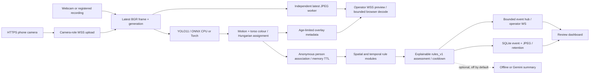

# Engineering audit and validation report

## Audit before this revision

- Remote transport already used relative URLs and a Cloudflare HTTPS tunnel. Gaps: host-based demo bypass was implicit, paired cameras had administrative access, secrets/settings lacked production validation, and diagnostics did not identify DNS/auth/backend failures.
- Capture and JPEG preview were already independent of inference. Gaps: the MJPEG viewer had no measured display/capture timestamp, layout changed with source aspect, frame drops/resource use were not systematically recorded, and reconnect state was incomplete.
- Motion/colour tracking retained IDs through short gaps, but its ID was presented as identity. No application-level identity history or tracker comparison metrics existed.
- Person/bag/knife rules were heuristics, not a learned threat model. An unowned stationary bag could become HIGH; proximity was described as ownership or custody transfer. Alerts had no versioned explanation/evidence schema, acknowledgement or false-positive workflow.
- Official YOLO11n/s weights and a small selected COCO val2017 check existed. Training was only an entrypoint: acquisition, group splitting, annotation audits, duplicate checks, held-out testing and experiment registry were missing.
- Existing tests covered the main previous defects. They did not cover roles, evidence review/retention, identity segments, dataset leakage, or measured tracking/event metrics.

## Implemented architecture

Verified 24 October 2026 on Windows, Intel i7-1360P (12 physical / 16 logical cores), Python 3.12, CPU inference using up to four configured inference threads. This is a research prototype, not validated security infrastructure.



Capture, preview encoding, inference and optional summaries are separated. Capture/inference use latest slots, not unbounded queues. The phone permits at most three unacknowledged frames and skips captures under congestion. The browser keeps one decoding frame and one latest pending frame. The video stage is fixed 16:9; drawing/overlays map to contained image pixels, excluding letterboxing. Only one active source/phone and one application process are supported; do not use multiple Uvicorn workers.

## Changes and paths

| Files | Result |
|---|---|
| app/config.py, .env.example | Environment settings with optional VISIONSHIELD_ prefix, HTTPS/public-origin validation, production disables local bypass. |
| app/core/security.py, app/web/routes.py, run.py | Camera/operator roles, origin checks, pairing limits, HttpOnly secure cookies, configured HTTPS tunnel, protected previews/evidence, diagnostic DNS/backend/auth codes. Public camera access was verified. |
| app/ingestion/video_stream.py | Latest-frame timestamps, independent JPEG encoding, USB retry/recovery, source generation guards, confined registered recordings, paced playback and EOF state. |
| app/engine/tracker.py, identity.py | Global Hungarian assignment replaces greedy pair consumption. Separate track segments and anonymous person IDs survive supported resets/reappearances; descriptors expire and ambiguous matches remain uncertain. |
| spatio_temporal.py, geofence.py, weapon.py, assessment.py | Repeated proximity evidence, restricted/object-monitor zones, neutral MEDIUM bag candidates, temporal knife gates, versioned explanations and cooldown. |
| app/db/database.py, migrations.py | Additive migration, preserved legacy records, UUID events, protected JPEG evidence, filters/review/delete, retention on startup and hourly. |
| app/core/observability.py, model_registry.py, logging_config.py | Bounded CPU/RAM/display/drop/stage metrics, actual checkpoint provenance and secret-redacted structured application logs. |
| app/web/templates/dashboard.html, static/js/dashboard.js, mobile.js, static/css/style.css | Stable preview, anonymous person/track labels, role QR dialog, zone purpose/dwell, evidence details/review/filters, recorded-mode labels, selected-track details and model insights. |
| app/research/datasets.py, scripts/research_dataset.py, research_train.py | Actual acquisition/audit/group split/COCO conversion/train/validation/test/export/registry workflow. |
| scripts/evaluate_tracking.py, evaluate_events.py, evaluate_holdout.py, tests/test_upgrade.py | Reproducible explicitly scoped metrics and critical regression coverage. |

Old unsupported guarantees were removed. Legacy events are labelled as predating the current review policy; legacy narrative reports without provenance no longer auto-populate the briefing. Fall/loitering heuristics and narrative reports are disabled by default. Existing MJPEG compatibility, source-specific zones, real inference and bounded event queues remain.

## Models and training status

| Component | Actual model/source | Status |
|---|---|---|
| Default detector | Official [Ultralytics YOLO11s](https://docs.ultralytics.com/models/yolo11/), yolo11s.pt, COCO 80 classes, runtime 640 px. | Vendor pretrained; deployed weights were not trained by this project. |
| Fast detector | Official YOLO11n, --fast uses 416 px. | Vendor pretrained; small-object recall can decrease. |
| ONNX backend | Hash-verified dynamic float32 export, opset 17, direct ONNX Runtime CPU; Torch fallback. | Same learned weights, no quantization/new training. |
| Local experiment | YOLO11n transfer learning: 1 epoch, 320 px, batch 2, freeze 10, seed 42, CPU. | Actually fine-tuned locally; inactive, not promoted. |
| Tracker/person association | Motion, torso HSV/brightness descriptor, Hungarian matching, camera/session scope. | Deterministic, no learned ReID/face recognition/cross-camera identification. |
| Assessment | rules_v1 ordinal LOW/MEDIUM/HIGH review policy. | No trained intent, violence or threat classifier; scores are not danger probabilities. |
| Optional summaries | Offline templates or configured Google Gemini. | Disabled by default; no local language/vision training. External API not tested. |
| Fall/loitering | Existing geometric/motion heuristics. | Disabled by default; no trained or medically validated model. |

Exact vendor source URLs, SHA-256 hashes, classes and checkpoint metadata are in artifacts/model-card.json. Experimental provenance/metrics are in artifacts/training-smoke.json and local data/models/registry.json; actual best.pt and best.onnx are retained under ignored runs/security. No generated weights or datasets were committed.

Person IDs have configurable default 120-second memory, descriptor distance <=0.10 and ambiguity margin >=0.04. Track mapping is camera/generation/track scoped; active identities cannot be taken by a new arrival. Gap links are explicitly uncertain. Only segment metadata, not descriptors, goes into SQLite. Clothing cannot verify identity.

For stronger ReID, the official [OSNet model zoo](https://github.com/KaiyangZhou/deep-person-reid/blob/master/docs/MODEL_ZOO.md) and [OSNet paper](https://arxiv.org/abs/1905.00953) were investigated. It is a plausible learned embedding candidate, but was not downloaded/integrated/benchmarked here. It needs representative consented video, rights review, calibrated thresholds and an additional inference budget. No cross-camera accuracy claim follows.

Ultralytics models/code require attention to [AGPL-3.0 or commercial licensing](https://www.ultralytics.com/license); downloading weights does not grant unrestricted proprietary deployment rights.

## Datasets: actual use and rights

| Dataset | Acquired/processed here? | Purpose and access |
|---|---|---|
| [COCO 2017](https://docs.ultralytics.com/datasets/detect/coco/) | Official converted labels; 20 selected development images and a disjoint 16-image local smoke subset. Not all full images. | Object boxes/classes, including person/bags/knife. Individual image rights remain applicable; see [COCO terms](https://cocodataset.org/#termsofuse). Manifest records annotation/converted-label sources and licensing notes. |
| [Open Images V7](https://storage.googleapis.com/openimages/web/download_v7.html) | Investigated only; not acquired/trained/evaluated. | Candidate broader object source; verify annotation and individual image licenses before acquisition. |
| [MOTChallenge](https://arxiv.org/abs/2010.07548), [MOT20](https://arxiv.org/abs/2003.09003) | Investigated only; not acquired/evaluated. | Candidate tracking videos; obtain official access/terms and preserve sequence boundaries. No MOT/HOTA results claimed. |
| [PETS unattended-object research](https://kev-smith.com/papers/SMITH_PETS06.pdf) | Reference only; actual files/access/terms not verified or used. | Candidate scenario source, not training evidence for an abandoned-bag model. |
| Synthetic rectangles/policy boxes | Generated and processed locally. | Explicitly SIMULATED implementation/transport/tracking fixtures; not real-world accuracy evidence. |

COCO's standard 2017 sizes (118,287 train / 5,000 validation) describe vendor data, not this project's acquired images. Local smoke data: 8 train / 4 validation / 4 test, 16 independent static-image groups. Train has 8 knife and 14 person boxes; val has 5 knives and 19 persons; test has 2 knives and 8 persons (19 total test boxes). Other categories remain labelled. Four positive/four negative training images and two positive/two negative images per local val/test were selected. This is tiny and unrepresentative.

Audits check finite/normalized boxes, class IDs, missing labels, hashes, exact cross-split duplicates, <=2-bit dHash near duplicates and sequence leakage. Three-band candidate indexing avoids an unconditional quadratic near-duplicate scan. Perceptual hashing is a screen, not proof of independence. For video, all related frames must share a sequence_id.

### Acquisition, training and evaluation commands

Run from the project directory:

```powershell
.\.venv\Scripts\python.exe -E scripts/prepare_validation.py
.\.venv\Scripts\python.exe -E scripts/research_dataset.py acquire-smoke
.\.venv\Scripts\python.exe -E scripts/research_dataset.py audit
.\.venv\Scripts\python.exe -E scripts/research_train.py --epochs 1 --imgsz 320 --batch 2 --device cpu
.\.venv\Scripts\python.exe -E scripts/evaluate_holdout.py
```

Prepare the development set first to reproduce the exclusions used by smoke acquisition. Manifests retain source/split/group/hash/rights notes. Large labels, images, recordings and weights remain Git-ignored. Preserve the manifest/checkpoint corresponding to each reported result.

For reviewed custom COCO-format annotations:

```powershell
.\.venv\Scripts\python.exe -E scripts/research_dataset.py convert-coco --annotations path\instances.json --images path\images --output datasets\custom
.\.venv\Scripts\python.exe -E scripts/research_dataset.py split --root datasets\custom
.\.venv\Scripts\python.exe -E scripts/research_dataset.py audit --root datasets\custom
.\.venv\Scripts\python.exe -E scripts/research_train.py --root datasets\custom --model yolo11s.pt --epochs 30 --imgsz 640 --batch 2 --freeze 0 --device cpu
```

Conversion remaps category IDs, excludes crowd boxes, clips boxes and rejects basename collisions. Include sequence_id on video image records before splitting. Add representative ordinary activities, benign tool use, crowd/occlusion and negative scenes with reviewed rights/consent. Full training can be expensive on CPU; use a configured GPU only when available. The example is a runnable workflow, not a claim that a substantial training run was completed.

Training audits first, selects best.pt on validation, tests without threshold tuning on test, evaluates the initial checkpoint on the same test, exports float32 ONNX and appends hash/config/metrics to the registry. Promotion is manual and should require representative independent video evidence.

## Measured model results

Actual one-epoch experiment, 320 px, four local held-out images:

| Checkpoint | Precision | Recall | mAP50 | mAP50–95 |
|---|---:|---:|---:|---:|
| Initial YOLO11n | 0.6937 | 0.4058 | 0.5559 | 0.4710 |
| Fine-tuned smoke best | 0.6496 | 0.3977 | 0.5593 | 0.4631 |

Validation mAP50=0.3368, mAP50–95=0.1923. Full train/validation/test/baseline/export experiment took 33.73 seconds. The tiny mAP50 increase does not compensate for worse mAP50–95/precision/recall: **not promoted**. Metrics aggregate classes present in this tiny check, not all-80-class deployment accuracy. Vendor COCO pretraining overlaps local training content; test is held out from local fine-tuning only, not an independent security benchmark.

The deployed YOLO11s/ONNX at 640 px, confidence 0.40 and IoU 0.50, on the four local test images: knife TP=1/FP=0/FN=1; person TP=3/FP=3/FN=5. Full class-wise precision/recall/F1 and sparse confusion counts are in artifacts/detector-heldout.json. The tiny sample cannot establish reliable precision/recall.

Historical selected development check: 20 images, 16 knives. Nano matched 3 knives with 1 unmatched prediction at 0.40; small matched 7 with 3 unmatched predictions. At the 0.55 warning gate, small matched 6 with 3 unmatched predictions. See artifacts/knife-validation*.json. Still-image box checks do not measure temporal alert accuracy, hand contact or danger.

## Tracking and rule evaluation

```powershell
.\.venv\Scripts\python.exe -E scripts/evaluate_tracking.py
.\.venv\Scripts\python.exe -E scripts/evaluate_events.py
```

Seven simulated tracking fixtures cover ordinary motion, occlusion, leave/return, actual crossing, similar clothing, simultaneous people and reset. Matching is one-to-one by IoU; IDF1 uses global identity-count assignment including unmatched predictions. identity_fragments counts distinct IDs minus one, not official MOT fragmentation. HOTA was not computed.

On perfect-detection rectangle fixtures, custom anonymous-person IDF1=1.0 with zero switches in all seven scenarios. Track-segment IDF1=0.5 at an intentional reset, while the person ID survives. Installed ByteTrack leave/return IDF1=0.5051 with one switch after its 30-frame buffer; other fixture IDF1 values=1.0. These scripted paths/buffers are not evidence of general superiority. Ambiguous-return/new-camera/expiry regressions separately require a new ID or uncertainty.

Ten deterministic policy scenarios all matched expected outputs: ordinary activity, bag outside zones, monitored bag, brief/sustained entry, weak/isolated/persistent/distant knife and bag near an associated person. First alerts: sustained entry 1.5 simulated seconds, bag 6 seconds, nearby knife 1 second. Scenario class P/R/F1=1.0 is only a gate check. Zero false alarms over 70 negative simulated seconds is not a real camera-hour rate. Full confusion and scope are saved in artifacts/event-evaluation.json.

## Performance and networking measurements

- Historical same-weight comparison: median Torch 241.1 ms versus ONNX CPU 208.4 ms. All 111 output boxes matched at IoU >0.98. See artifacts/backend-benchmark.json. This measures detector calls, not UI/network latency.
- Latest offline isolation check: synthetic 640x480, YOLO11s/640 ONNX CPU, 21.6 preview FPS, 5.2 inference FPS, final detector call 186.2 ms, preview encode age 16.9 ms. See artifacts/preview-benchmark.json. Prior optimized preview was about 20.4 FPS, but load differs: no controlled speedup is claimed for this revision.
- Final actual Chromium run: synthetic 320x240 HTTP upload input, 12.1 preview FPS, 9.33 average displayed FPS (including startup), 5.2 inference FPS, last detector call 187.7 ms. 92 frames received/encoded; 36 inferred, 52 skipped between consumed frames (59.09% measured inference skip rate). Skipping avoids a stale backlog.
- Browser receive-to-display estimate was 9.3 ms with ±5.5 ms midpoint clock uncertainty. This excludes hardware sensor and HTTP upload delay for this synthetic test. It is not measured physical camera-to-display latency. Real phone frames include client capture timestamps, but physical-device latency remains unmeasured.
- Final active resource samples: approximately 237–241 MB process RSS and 153.1–337.5% CPU, where 100% is one logical core. The phone-page synthetic camera sustained 12.3 uploads/s at 640x480, separate from inference throughput. Full metrics/stages are in artifacts/browser-verification.json.
- Real temporary Cloudflare HTTPS/WSS test: unpaired API=401, camera pairing=200, camera-to-operator API=403, operator insights=200, ten JPEG frames acknowledged. Latest sequential upload roundtrip rate=4.01 FPS; the production bounded sender differs from this deliberately sequential smoke test. See artifacts/remote-verification.json.

There is no trustworthy pre-revision sensor/display latency baseline, so no numerical end-to-end improvement is asserted. Physical phone permissions/carrier behavior/backgrounding, webcam scenes and sensor delay require device acceptance. Tests did not fabricate those results.

## Verification and operational status

- Dependencies installed; pip check passes. Direct additions: scipy, lap, pycocotools and psutil; Ruff is a development tool. Exact installed versions are in requirements.lock.txt.
- **42 Python tests passed**: access/origin boundaries, model load/inference failure, USB recovery, identity reset/ambiguity/expiry, evidence/review/delete/filter, migration/retention, source/stale overlays, temporal rules and dataset leakage.
- Ruff formatting/lint and Python compilation passed; JavaScript syntax checks passed. A non-failing Starlette TestClient deprecation warning remains in dependencies.
- Node transport fixture: 500 ms RTT, seven sends in about 1.1 seconds, at most three in flight, source switch releases camera.
- Chromium at 1440 px desktop and 390 px mobile passed without horizontal overflow or runtime exceptions: preview/events, zones, pairing dialog, filtered event details/evidence/false-positive/deletion, simulated phone camera start/stop and recorded-source selection. Screenshots are in artifacts/.
- Public remote transport and role separation were verified through a real tunnel, in addition to in-process API tests.
- Verification server/tunnel are stopped after checks. Clean application worker/capture shutdown was observed; restart manually using README/DEMO_GUIDE commands.

No automated check remains failing. External Gemini and physical-device acceptance remain untested. Synthetic recordings are labelled SIMULATED and never inject ground-truth detections into live inference.

## Remaining limits and next priorities

1. Acquire consented, independently held-out deployment video: lighting, occlusion, ordinary activity, benign tools and actual camera geometry. Measure false alarms per real camera-hour and missed events.
2. Expand annotations and run meaningful GPU fine-tuning with a frozen vendor baseline; audit sequence leakage and label quality before promotion. The 16-image experiment proves workflow only.
3. Calibrate learned ReID if validated matching quality justifies its latency/cost. Similar clothing cannot establish real identity.
4. Complete the physical phone-on-cellular/webcam rehearsal and measure clock uncertainty, drops and scene-specific misses.
5. Production needs individual accounts, per-device revocation, access audit trails, stable TLS deployment and load/resource/retention hardening. Shared secrets and an ephemeral tunnel remain prototype constraints. Different phones share phone-mode zones; redraw after changing scene.
